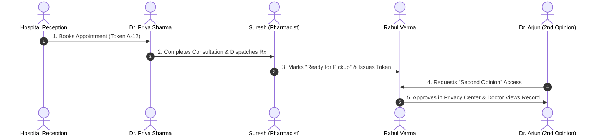

# MediLink - Connected Sovereign Healthcare Platform
> **College Full Stack Development (FSD) Project**  
> A unified platform connecting **Hospitals, Doctors, Patients, and Pharmacists** around a single sovereign Patient Medical Record with consent-based privacy controls.

---

## 🌟 Key Highlights & Architectural Features

1. **One Patient Record Across Multiple Hospitals**:
   - Patient holds a single lifetime MediLink ID (e.g. `ML-PAT-1001`) and interactive digital QR passport.
   - Apollo Multispeciality Hospital and BMSCE Healthcare access the same synchronized record.
2. **Sovereign Privacy Center & Consent Sharing**:
   - Zero-unauthorized data exposure: Doctors cannot view patient history without an active appointment or approved access grant.
   - Outside doctors request "Second Opinion" access; patients configure scope (`FULL`, `PRESCRIPTIONS_ONLY`, `LABS_ONLY`) and duration (`24h`, `7d`, `30d`).
   - Granular instant **Revoke Access** button and transparent immutable **Audit Log**.
3. **Prescription Builder & AI/OCR Scanner**:
   - Doctor consultation suite with vitals tracking and "Note for Future Doctors" cross-hospital handover.
   - Interactive simulated OCR scanner: parses handwritten/printed prescriptions, extracts diagnosis, vitals, and medication entities with doctor review & confirm.
   - Instant automated routing to the Pharmacist live queue.
4. **Live Pharmacy Dispensary & Pickup Token Engine**:
   - Progressive workflow: *Sent $\to$ Preparing $\to$ Ready for Pickup (Auto Token #) $\to$ Dispensed*.
   - Out-of-stock toggles trigger real-time alerts to doctor and patient.
5. **Smart Reminders Rules Engine**:
   - Condition-based automated reminders (e.g., Kidney Stones $\to$ 2h hydration; Diabetes $\to$ morning glucose check; Hypertension $\to$ BP record).
   - Auto-generated medication reminders from active prescriptions.
6. **Dynamic Custom Records & Recharts**:
   - Patients can define custom metrics (Blood Sugar, Blood Pressure, Thyroid, Peak Flow) with custom fields and automated interactive trend graphs.
7. **Demo Persona Fast Switcher**:
   - 1-click persona switching on the navbar or login screen to jump between Receptionist, Doctor, Patient, and Pharmacist instantly during presentations.

---

## 🚀 Quick Start Instructions

### Prerequisites
- Node.js (v18+) & npm
- Python 3.10+ (for Phase 2 backend)

### 1. Run the Frontend (React + Vite)
```bash
# In the project root (healthsync)
npm install
npm run dev
```
Open **[http://localhost:5173](http://localhost:5173)** in your browser.

---

## 🎬 3-Minute Presentation Demo Walkthrough Script

Follow these 5 steps to showcase the complete end-to-end synchronized flow:



1. **Step 1: Hospital Books Appointment**
   - Click **Demo Switcher $\to$ Anita Desai (Hospital Reception)**.
   - View Today's appointments and click **"Book Appointment"**.
   - Select patient **Rahul Verma (`ML-PAT-1001`)** with **Dr. Priya Sharma** (Cardiology).
   - Click **Confirm Booking**. Token is generated immediately!
2. **Step 2: Doctor Writes & Scans Prescription**
   - Switch to **Dr. Priya Sharma (Doctor Portal)**.
   - In Today's Queue, click **"Start Consultation"** for Rahul Verma.
   - Click **"Scan / Upload Rx (OCR)"** to demonstrate AI prescription parsing.
   - Review pre-filled diagnosis and medicines, click **"Complete Consultation & Dispatch"**.
3. **Step 3: Pharmacist Prepares & Issues Token**
   - Switch to **Suresh Gupta (Pharmacy Portal)**.
   - In Live Rx Queue, observe Rahul's new prescription marked **Sent**.
   - Click **"Accept & Start Preparing"**, then **"Mark Ready"**.
   - System assigns a pickup token (e.g. `TK-23`) and dispatches a live notification to Rahul!
4. **Step 4: Patient Reviews Tracker & Consents**
   - Switch to **Rahul Verma (Patient Portal)**.
   - In Dashboard, see the live prescription tracker in **Ready for Pickup** state with token #.
   - Open **Privacy Center** to see an incoming access request from **Dr. Arjun Menon**.
   - Click **"Configure & Approve"** $\to$ choose **Full Clinical History** for **7 Days** $\to$ **Authorize**.
5. **Step 5: Second Opinion Doctor Unlocks Record**
   - Switch to **Dr. Arjun Menon (Second Opinion Doctor)**.
   - Go to **Second Opinion** page.
   - Observe the request status is now **Approved**! Click **"Open Sovereign Record"** to review Rahul's complete clinical timeline and vitals.

---

## 📁 Project Structure

```
healthsync/
├── backend/                       # Phase 2 FastAPI + MySQL Backend
│   ├── main.py                    # REST API endpoints & CORS
│   ├── database.py                # SQLAlchemy engine & session
│   ├── models.py                  # 22 Relational ORM models
│   ├── schemas.py                 # Pydantic v2 schemas
│   ├── auth.py                    # JWT auth & password hashing
│   ├── requirements.txt           # Python dependencies
│   └── schema.sql                 # Complete MySQL DDL & ER diagram
├── src/
│   ├── api/                       # Modular Promise-based API layer
│   │   ├── mockData.js            # Realistic seed database
│   │   ├── storage.js             # Reactive localStorage engine
│   │   ├── authApi.js             # Auth & demo personas
│   │   ├── patientApi.js          # Patient records & timeline
│   │   ├── doctorApi.js           # Consultation & queue
│   │   ├── hospitalApi.js         # Registration & booking
│   │   ├── pharmacyApi.js         # Rx queue & tokens
│   │   ├── consentApi.js          # Sovereign privacy & audit logs
│   │   ├── reminderApi.js         # Condition rules engine
│   │   └── notificationApi.js     # Real-time bell alerts
│   ├── context/
│   │   ├── AuthContext.jsx        # User state & persona switcher
│   │   ├── NotificationContext.jsx# Floating toasts & notifications
│   │   └── ThemeContext.jsx       # Light & dark mode
│   ├── components/
│   │   ├── common/                # Navbar, Sidebar, QRModal, ThemeToggle
│   │   ├── charts/                # DynamicMetricChart (Recharts)
│   │   └── scan/                  # PrescriptionScannerModal (Simulated OCR)
│   └── pages/
│       ├── auth/                  # LoginPage
│       ├── hospital/              # HospitalDashboard, ManageStaffPage
│       ├── doctor/                # DoctorQueue, ConsultationPage, SecondOpinionPage
│       ├── patient/               # PatientDashboard, PatientTimeline, HealthProfilePage,
│       │                          # DynamicRecordsPage, PrivacyCenterPage, SmartRemindersPage
│       └── pharmacy/              # PharmacyQueue, PharmacyStockPage
├── tailwind.config.js
└── package.json
```

---

## 🗄️ Database Architecture (MySQL Phase 2)

The database consists of **22 normalized relational tables**:
- `users`, `roles`, `hospitals`, `doctors`, `patients`, `pharmacists`
- `appointments`, `consultations`, `prescriptions`, `prescription_items`, `pharmacy_orders`
- `health_profiles`, `custom_record_types`, `custom_record_fields`, `custom_record_entries`, `documents`
- `access_requests`, `access_grants`, `audit_logs`
- `reminders`, `reminder_rules`, `notifications`

### Running Phase 2 FastAPI Backend
```bash
# In healthsync/backend directory
cd backend
python -m venv venv
venv\Scripts\activate          # On Windows
pip install -r requirements.txt

# Start FastAPI server
uvicorn main:app --reload --port 8000
```
Interactive Swagger API documentation: **[http://localhost:8000/docs](http://localhost:8000/docs)**.

---

## 🎨 Design System
- **Colors**: Clinical white, teal (`#0d9488`), emerald, slate navy.
- **Typography**: Plus Jakarta Sans / Inter.
- **Dark Mode**: Fully supported with smooth transitions.
- **Responsive**: Desktop, tablet, and mobile layouts.
